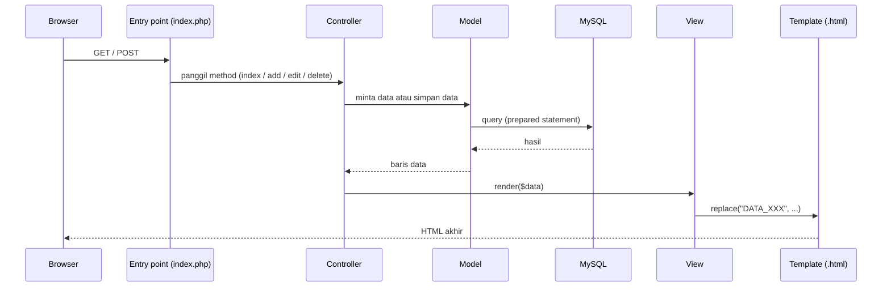
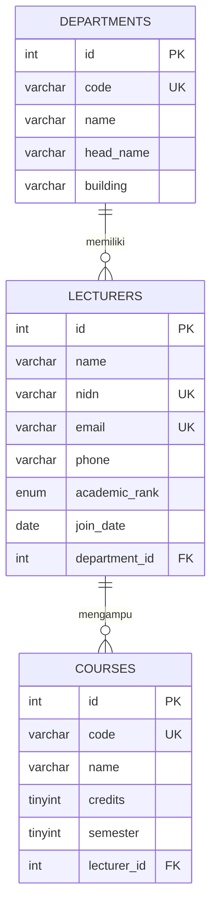

# Tugas Praktikum DPBO - Arsitektur MVC (PHP Native + MySQL)

**Nama**  : [isi nama]
**NIM**   : [isi NIM]
**Kelas** : [isi kelas]

Aplikasi web **Akademik MVC** untuk mengelola data **Program Studi**, **Dosen**, dan **Mata Kuliah**.
Program ini merupakan hasil refactoring dari kode starter non-MVC (`tp_mvc25`, yang hanya mengelola tabel `lecturers`)
menjadi arsitektur **Model-View-Controller** murni dengan PHP Native dan MySQL, serta ditambah dua tabel baru yang
berelasi melalui Foreign Key.

## Daftar Isi

1. [Teknologi](#teknologi)
2. [Struktur Repositori](#struktur-repositori)
3. [Desain Program dan Arsitektur MVC](#desain-program-dan-arsitektur-mvc)
4. [Skema Database dan ERD](#skema-database-dan-erd)
5. [Alur Kerja Aplikasi (CRUD)](#alur-kerja-aplikasi-crud)
6. [Keamanan](#keamanan)
7. [Cara Menjalankan (Laragon)](#cara-menjalankan-laragon)
8. [Dokumentasi](#dokumentasi)

## Teknologi

| Komponen | Keterangan |
|---|---|
| Bahasa | PHP Native (tanpa framework), gaya OOP |
| Database | MySQL / MariaDB (mysqli + prepared statement) |
| Server | Laragon (Apache + phpMyAdmin) |
| Antarmuka | HTML5 + Bootstrap 5.0.2 (file lokal di `Project/assets/`) + CSS kustom |

## Struktur Repositori

```
.
├── Project/                      # Seluruh source code aplikasi MVC
│   ├── config.php                # Konfigurasi koneksi database (class Config)
│   ├── index.php                 # Entry point: halaman Dosen
│   ├── department.php            # Entry point: halaman Program Studi
│   ├── course.php                # Entry point: halaman Mata Kuliah
│   ├── models/
│   │   ├── DB.php                # Base database handler
│   │   ├── Department.php        # Model tabel departments
│   │   ├── Lecturer.php          # Model tabel lecturers
│   │   └── Course.php            # Model tabel courses
│   ├── views/
│   │   ├── Template.php          # Template engine (parser placeholder)
│   │   ├── DepartmentView.php
│   │   ├── LecturerView.php
│   │   └── CourseView.php
│   ├── controllers/
│   │   ├── BaseController.php    # Helper bersama (flash message, redirect, sanitasi)
│   │   ├── DepartmentController.php
│   │   ├── LecturerController.php
│   │   └── CourseController.php
│   ├── templates/                # Kerangka UI (.html) dengan placeholder DATA_XXX
│   │   ├── navbar.html
│   │   ├── index.html            # Template halaman Dosen
│   │   ├── department.html
│   │   └── course.html
│   └── assets/
│       ├── bootstrap.min.css
│       ├── bootstrap.bundle.min.js
│       └── style.css
├── SQL/
│   └── tp_mvc25.sql              # Struktur tabel + data dummy
├── Dokumentasi/                  # Screenshot / screen record + panduannya
└── README.md
```

## Desain Program dan Arsitektur MVC

Kode starter mencampur query SQL, logika alur, dan HTML dalam satu file PHP (`index.php`, `create.php`,
`edit.php`, `delete.php`). Pada versi ini tanggung jawab dipisah menjadi tiga lapisan.

| Lapisan | Folder | Tanggung jawab |
|---|---|---|
| **Model** | `models/` | Satu-satunya tempat query SQL. Class `DB` menangani koneksi dan eksekusi query (termasuk prepared statement). Tiap tabel punya model yang `extends DB`. |
| **View** | `views/` + `templates/` | View menyiapkan data tampilan (membuat baris tabel, opsi dropdown, nilai form) lalu mengisi template. `Template` menggantikan placeholder `DATA_XXX` pada file `.html`. |
| **Controller** | `controllers/` | Penghubung Model dan View: menerima input, memvalidasi, memanggil Model, menyimpan pesan, lalu meneruskan data ke View. **Tidak ada query SQL** di controller. |

Entry point (`index.php`, `department.php`, `course.php`) hanya memilih method controller berdasarkan request
(`$_POST` / `$_GET`).

### Penjelasan class

| Class | File | Peran |
|---|---|---|
| `Config` | `config.php` | Menyimpan host, user, password, dan nama database sebagai properti static (default Laragon: `localhost`, `root`, kosong, `tp_mvc25`). |
| `DB` | `models/DB.php` | `open()`, `execute()`, `executePrepared()`, `getResult()`, `getErrno()`, `close()`. `executePrepared()` memisahkan SQL dari data sehingga aman dari SQL injection. |
| `Department`, `Lecturer`, `Course` | `models/` | Query per entitas: `getXxx()` (dengan `JOIN`), `getXxxById()`, `add()`, `update()`, `delete()`. |
| `Template` | `views/Template.php` | `replace()`, `write()`, `getContent()`, `clear()`; helper `e()` (escape HTML), `navbar()`, `flash()`. |
| `DepartmentView`, `LecturerView`, `CourseView` | `views/` | Method `render($data)` menyusun HTML dinamis dan mengisi template. |
| `BaseController` | `controllers/BaseController.php` | Helper bersama: `value()`, `validId()`, `setFlash()`, `getFlash()`, `redirect()`, `dbMessage()`. |
| `DepartmentController`, `LecturerController`, `CourseController` | `controllers/` | Method `index()`, `add()`, `edit()`, `delete()`, validasi input, dan pengambilan data dropdown relasi. |

### Alur satu request



Untuk operasi tulis (tambah, ubah, hapus) controller melakukan redirect setelah proses selesai (pola
*Post/Redirect/Get*), sehingga refresh halaman tidak mengirim ulang form.

## Skema Database dan ERD

Database: **`tp_mvc25`**. Tabel `lecturers` berasal dari starter; `departments` dan `courses` adalah tabel baru.



### Penjelasan tabel

| Tabel | Status | Keterangan |
|---|---|---|
| `departments` | **Baru** | Data program studi: kode, nama, ketua prodi, gedung. |
| `lecturers` | Lama (diperluas) | Atribut lama: `id`, `name`, `nidn`, `phone`, `join_date`. Atribut baru: `email`, `academic_rank`, `department_id` (FK). |
| `courses` | **Baru** | Data mata kuliah: kode, nama, SKS, semester, dan dosen pengampu (`lecturer_id`, FK). |

### Relasi dan aturan integritas

| Relasi | Kardinalitas | Foreign Key | Aturan |
|---|---|---|---|
| Program studi - Dosen | 1 : N | `lecturers.department_id` -> `departments.id` | `ON DELETE RESTRICT`, `ON UPDATE CASCADE` |
| Dosen - Mata kuliah | 1 : N | `courses.lecturer_id` -> `lecturers.id` | `ON DELETE RESTRICT`, `ON UPDATE CASCADE` |

- `ON DELETE RESTRICT`: program studi yang masih punya dosen, atau dosen yang masih mengampu mata kuliah, **tidak
  dapat dihapus**. Aplikasi menampilkan pesan yang jelas, bukan error database.
- `UNIQUE`: `departments.code`, `lecturers.nidn`, `lecturers.email`, `courses.code`.
- `CHECK`: `courses.credits` bernilai 1-6 dan `courses.semester` bernilai 1-8.
- Data dummy pada `SQL/tp_mvc25.sql`: **4 program studi, 8 dosen, 12 mata kuliah**.
- File SQL memuat `DROP TABLE IF EXISTS`, sehingga aman diimpor ulang untuk mengembalikan data awal.

## Alur Kerja Aplikasi (CRUD)

Navigasi memiliki tiga menu: **Dosen** (`index.php`), **Program Studi** (`department.php`), dan **Mata Kuliah**
(`course.php`). Setiap halaman berisi form di sisi kiri dan tabel di sisi kanan (menumpuk pada layar kecil).
Alurnya sama untuk ketiga entitas:

| Operasi | Request | Proses |
|---|---|---|
| **Read** | `GET halaman.php` | Controller mengambil data lewat Model (dengan `JOIN` untuk menampilkan nama relasi), View menyusun tabel dan dropdown. |
| **Create** | `POST add` | Controller memvalidasi input, Model menjalankan `INSERT` (prepared statement), lalu redirect dengan pesan sukses atau error. |
| **Update** | `GET ?id_edit=ID` lalu `POST update` | Form terisi data lama dan tombol berubah menjadi *Simpan Perubahan*. Setelah disimpan, Model menjalankan `UPDATE` lalu redirect. |
| **Delete** | `POST delete` (dengan konfirmasi) | Model menjalankan `DELETE`. Jika terhalang Foreign Key, tampil pesan error yang menjelaskan alasannya. |

Hal yang ditampilkan lewat relasi:

- **Dosen**: dropdown *Program Studi* pada form Create/Edit; kolom *Program Studi* pada tabel diambil dengan `JOIN departments`.
- **Mata Kuliah**: dropdown *Dosen Pengampu* pada form; tabel menampilkan nama dosen dan program studinya (`JOIN lecturers` dan `JOIN departments`).
- **Program Studi**: kolom *Jumlah Dosen* dihitung dengan `LEFT JOIN` + `COUNT`.

Validasi sisi server (selain atribut HTML5) mencakup: NIDN 10 digit, format email, format telepon, jabatan
akademik sesuai pilihan, tanggal valid, kode prodi/mata kuliah berformat benar, SKS 1-6, semester 1-8, dan ID
relasi harus dipilih. Kesalahan database (duplikat, FK tidak valid, FK masih dipakai) diterjemahkan menjadi pesan
bahasa Indonesia.

## Keamanan

| Ancaman | Penanganan |
|---|---|
| SQL Injection | Semua query yang memakai input pengguna menggunakan **prepared statement** (`DB::executePrepared`). |
| XSS | Semua data dari database dan form di-escape dengan `Template::e()` (`htmlspecialchars`) sebelum dicetak. |
| Hapus lewat link (GET) | Penghapusan memakai **POST** dengan dialog konfirmasi, bukan link `delete.php?id=...`. |
| Input tidak valid | Divalidasi di controller sebelum menyentuh database. |
| Merusak hasil render | `Template::replace()` memakai `str_replace`, bukan `preg_replace`, sehingga karakter seperti `$1` atau `\` aman. |

## Cara Menjalankan (Laragon)

1. Jalankan **Laragon** (Start All), pastikan Apache dan MySQL aktif.
2. Salin folder `Project/` ke direktori web Laragon, misalnya `C:\laragon\www\tp_mvc25\`.
3. Buka phpMyAdmin (`http://localhost/phpmyadmin`), tab **Import**, pilih `SQL/tp_mvc25.sql`, lalu klik **Go**.
   File ini sudah membuat database `tp_mvc25` beserta tabel dan data dummy.
4. Jika kredensial MySQL berbeda dari default (user `root`, password kosong), ubah `Project/config.php`.
5. Buka `http://localhost/tp_mvc25/` (atau `http://tp_mvc25.test/` bila auto virtual host Laragon aktif).

Persyaratan: PHP 7.4 atau lebih baru dengan ekstensi `mysqli` dan `mysqlnd` (aktif secara bawaan di Laragon).

## Dokumentasi

Daftar screenshot dan screen record yang perlu diambil ada di
[`Dokumentasi/PANDUAN_DOKUMENTASI.md`](Dokumentasi/PANDUAN_DOKUMENTASI.md). Setelah file gambar dimasukkan ke
folder `Dokumentasi/`, tampilannya muncul pada bagian di bawah ini.

### Struktur database


### Halaman Dosen


### Halaman Program Studi


### Halaman Mata Kuliah


### Validasi dan tampilan responsif


### Screen record

Rekaman alur lengkap CRUD: [`Dokumentasi/99-screen-record-crud.mp4`](Dokumentasi/99-screen-record-crud.mp4)
